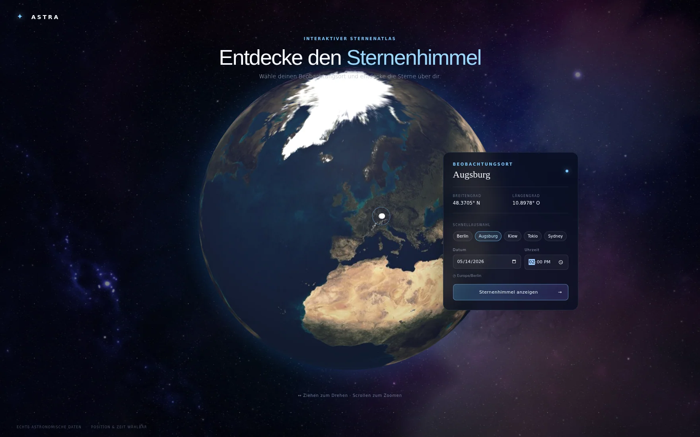
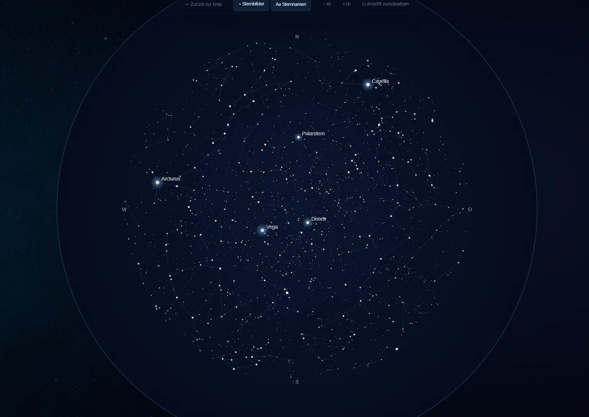
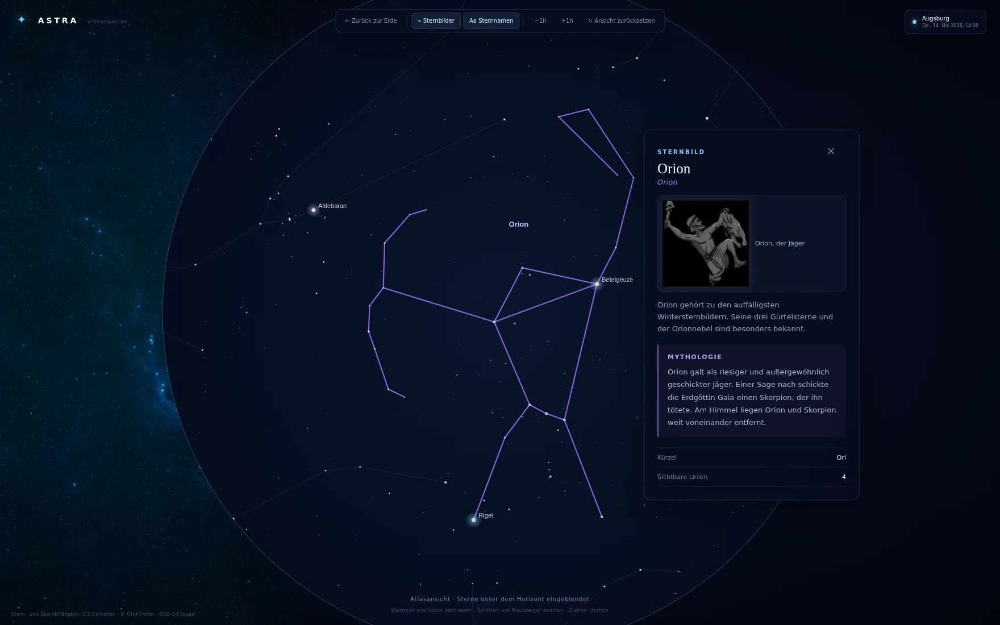

<div align="center">

# ✦ ASTRA

### Interaktiver Sternenatlas

**Den Sternenhimmel entdecken – passend zu Ort, Datum und Uhrzeit.**

React · TypeScript · Vite · Three.js · Astronomy Engine · D3-Celestial

</div>

**[Live-Demo](https://dmytro-moldovanu.github.io/Astra/)** · **[GitHub-Repository](https://github.com/Dmytro-Moldovanu/Astra)**

## Projektüberblick

**ASTRA** ist eine interaktive Webanwendung zur Erkundung des Sternenhimmels. Auf einem drehbaren 3D-Globus lässt sich ein Beobachtungsort auswählen. Aus dessen geografischen Koordinaten und der gewählten Zeit wird eine lokale Sternkarte berechnet. Die Anwendung verbindet eine astronomische Visualisierung mit einer leicht zugänglichen Einführung in Sternbilder und die Geschichten hinter ihren Namen.

Die Darstellung läuft im Browser. Es ist kein Benutzerkonto und kein eigener Backend-Dienst nötig.

## Funktionen

- **Interaktive Erde:** Ort auf dem Globus auswählen oder eine Stadt aus der Schnellauswahl übernehmen; Breiten- und Längengrad sowie Zeitzone werden angezeigt.
- **Tag und Nacht:** Die Erdtextur verbindet Tagesansicht und nächtliche Stadtlichter anhand des berechneten Sonnenstands.
- **Lokale Sternkarte:** Die Positionen der katalogisierten Sterne und Sternbilder werden für Standort, Datum und Uhrzeit berechnet.
- **Direkte Navigation:** Karte drehen, am Mauszeiger zoomen sowie ausgewählte Sterne und Sternbilder zentrieren.
- **Atlasansicht:** Bei der Auswahl eines Sternbildes können Katalogsterne unterhalb des lokalen Horizonts eingeblendet werden, um die ganze Figur darzustellen; beim Schließen kehrt die Ansicht zurück.
- **Konstellationen entdecken:** Auswahl aus **25 illustrierten Sternbildern**, die zum gewählten Zeitpunkt zumindest teilweise über dem Horizont stehen.
- **Wissen und Mythologie:** **88** kurze Sternbildbeschreibungen; für die **25** illustrierten Figuren zusätzlich kurze traditionelle Mythen und Hintergrundgeschichten.
- **Zeitnavigation:** Beobachtungszeit in Stundenschritten verschieben; Sternnamen und Verbindungslinien ein- oder ausblenden.

## Rundgang durch ASTRA

### 01 · Erde – Beobachtungsort und Zeitpunkt auswählen



Der Einstieg beginnt auf einem **interaktiven 3D-Globus**. Die Erde lässt sich drehen und zoomen; ein Klick auf die Oberfläche bestimmt die geografischen Koordinaten des Beobachtungsorts. Alternativ stehen Berlin, Augsburg, Kiew, Tokio und Sydney als Schnellauswahl zur Verfügung. In der Informationskarte können **Datum und Uhrzeit** für die anschließende Himmelsansicht festgelegt werden.

Die Darstellung wechselt abhängig vom berechneten Sonnenstand zwischen Tages- und Nachtseite. Die Nachttextur zeigt Stadtlichter, während der Hintergrund die Ansicht räumlich ergänzt.

### 02 · Sternkarte – Den Himmel über dem gewählten Ort erkunden



Nach dem Wechsel in die Himmelsansicht erscheint eine **interaktive Sternkarte** für den zuvor gewählten Ort und Zeitpunkt. Sterne, markante Sternnamen und Verbindungslinien der Sternbilder werden anhand astronomischer Daten dargestellt. Mit der Maus lässt sich die Ansicht drehen und zoomen; die Bedienleiste erlaubt es, die Beobachtungszeit in **Stundenschritten** zu verändern sowie Sternnamen und Sternbildlinien ein- oder auszublenden.

Rechts werden **mythologisch illustrierte Sternbilder** aufgeführt, von denen aktuell zumindest ein Teil rechnerisch über dem Horizont liegt. Ein Klick auf einen Eintrag öffnet dieselbe Detailansicht wie die Auswahl auf der Karte.

### 03 · Sternbild – Astronomie und Mythologie verbinden



Bei der Auswahl wird das Sternbild **zentriert und näher herangeholt**. Die Informationskarte zeigt seinen Namen, eine Illustration, eine kurze astronomische Beschreibung, eine **mythologische Überlieferung**, das internationale Kürzel und die Zahl seiner dargestellten Verbindungslinien. Für die 25 illustrierten Sternbilder sind eigene Geschichten hinterlegt; die grundlegenden Beschreibungen umfassen alle **88 offiziellen Sternbilder**.

Damit auch Sternbilder am Rand der üblichen Himmelsansicht vollständig betrachtet werden können, ergänzt die **Atlasansicht** bei Bedarf Sterne unterhalb des lokalen Horizonts. Beim Schließen der Karte kehrt die Darstellung zum normalen Überblick zurück.

## Technik

| Bereich | Umsetzung |
|---|---|
| Benutzeroberfläche | React 19, TypeScript, CSS |
| Entwicklungswerkzeuge | Vite 7, TypeScript |
| 3D-Globus | `react-globe.gl` / Three.js |
| Astronomische Berechnungen | `astronomy-engine` |
| Stern- und Sternbilddaten | D3-Celestial (BSD-3-Clause) |
| Zeitzonenermittlung | `tz-lookup` |
| Illustrationen | Stellarium / Johan Meuris (Free Art License 1.3) |

Die Sternkarte basiert auf horizontalen Koordinaten (Azimut und Höhe) für den jeweiligen Beobachtungsort. Die grafische Darstellung ist eine **didaktische Himmelskarte** und keine fotografische Aufnahme oder vollwertige Planetariumsprojektion. Die figurativen Stellarium-Illustrationen werden in Informationskarten angezeigt; sie sind nicht deckungsgleich mit allen gezeichneten Sternbildlinien.

## Projektstruktur

```text
src/
  App.tsx                     Anwendungsnavigation und Zustand
  EarthScreen.tsx             Globus und Ortswahl
  SkyScreen.tsx               Sternkarte, Auswahl und Navigation
  astronomy.ts               Horizont- und Sonnenberechnungen
  earthLighting.ts           Tag-/Nacht-Textur
  constellationDescriptions.ts  Texte zu 88 Sternbildern
  constellationMyths.ts       Mythologische Kurztexte zu 25 Sternbildern
  mythicConstellations.tsx    Darstellung und Zuordnung der Illustrationen
  styles.css                 Layout und Darstellung
public/
  data/                      Sternkatalog und Verbindungslinien
  constellation-art/         25 Sternbildillustrationen (WebP)
  earth-day.jpg              Tagestextur
  earth-night.png            Nachttextur
  earth-bump.png             Höhenkarte
  # Startseitenfoto N44 wird extern vom offiziellen ESA/Hubble-CDN geladen
  space-background.jpg       Bisheriger Hintergrund der Sternkarte
scripts/
  check-content.mjs          Prüft Sternbilder, Texte, Bilder und Schriftsysteme
```

## Daten, Illustrationen und Lizenzen

- **Astronomische Katalogdaten:** D3-Celestial, Olaf Frohn – BSD-3-Clause; Lizenzkopie unter `public/data/D3-CELESTIAL-LICENSE.txt`.
- **Sternbildillustrationen:** Johan Meuris, bereitgestellt durch Stellarium – **Free Art License 1.3**. Die Zeichnungen stehen ausdrücklich nicht unter Public Domain. [Quelle](https://github.com/Stellarium/stellarium-skycultures/tree/master/western) · [Lizenz](https://artlibre.org/licence/lal/en/).
- **Erdtexturen:** Three.js / three-globe-Beispieldateien; Ursprungs- und Lizenzhinweise siehe [Quellen und Lizenzen](docs/QUELLEN_UND_LIZENZEN.md).
- **Startseiten-Hintergrund:** [NASA/ESA-Hubble-Aufnahme N44](https://esahubble.org/images/potm2608a/), UHD 3840 × 2160, via offiziellem ESA/Hubble-CDN, **CC BY 4.0**, Bildnachweis: ESA/Hubble & NASA, D. Gouliermis. Die Sternkarte ist davon unabhängig.
- **Mythologische Texte:** Kurze Nacherzählungen verschiedener Überlieferungen. Varianten werden ausdrücklich als solche beschrieben.

## Hinweise und Grenzen

- Die 25 illustrierten Sternbilder sind eine kuratierte Auswahl, nicht eine vollständige Illustration aller 88 IAU-Sternbilder.
- Die Sichtbarkeitsliste prüft, ob Teile der ausgewählten Sternbilder rechnerisch über dem Horizont liegen; lokale Hindernisse, Wetter, Lichtverschmutzung oder Sonnenaufgang werden nicht simuliert.
- Bei Tageslicht wird eine entsprechend gekennzeichnete Lernansicht gezeigt, keine tatsächliche Sichtbarkeit der Sterne.
- Das Datum und die Zeit lassen sich simulieren; die Darstellung aktualisiert sich nicht sekündlich automatisch.
- Das Umschalten zwischen Tages- und Nachtseite der Erde verwendet eine vereinfachte Dämmerungszone.

---

**ASTRA** · Interaktiver Sternenatlas · Projekt von [Dmytro Moldovanu](https://github.com/Dmytro-Moldovanu)
